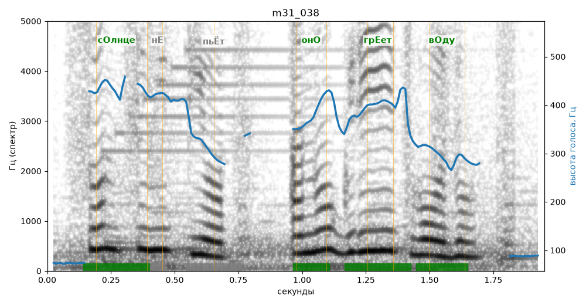

# m31_038

Голос: **Пик (серия 31, 119.8 с)** · длительность 1.9 с
Естественность (UTMOS): **1.28 из 5** (живой диктор ≈ 4–4.5)
Эталон: Солнце не пьёт. Оно греет воду.
Распознано: Солнце не пьет, оно греет воду.
Слова: все совпали

## Ударения
(где нужно: ruaccent)

| слово | нужно | у голоса | |
|---|---|---|---|
| солнце | сОлнце | сОлнце | ✓ |
| оно | онО | онО | ✓ |
| греет | грЕет | грЕет | ✓ |
| воду | вОду | вОду | ✓ |

## Интонация
- ✓ «солнце не пьёт.» — конец фразы понижается — звучит законченно
- ✓ «оно греет воду.» — конец фразы понижается — звучит законченно
- Диапазон голоса 30.8 полутонов (живо), средняя высота 353 Гц

## Паузы и темп
- паузы на своих местах
- Темп 7.7 слога/с (быстро)

_Синяя линия — высота голоса. Над словами заглавная буква — где ударение должно быть; красным — голос поставил не туда (уверенно), оранжевым — возможно._
