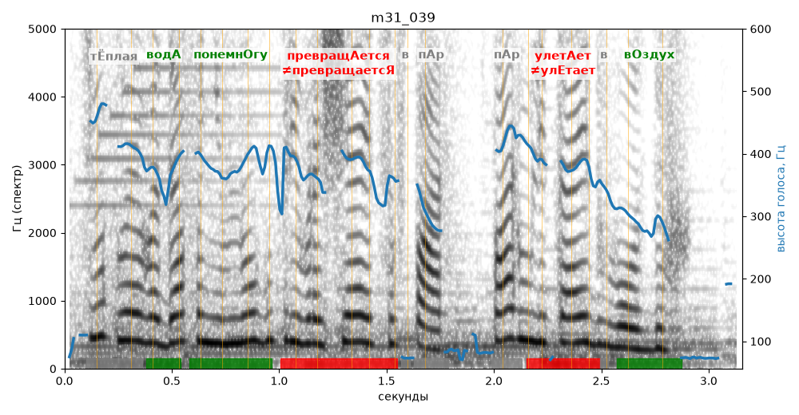

# m31_039

Голос: **Пик (серия 31, 121.9 с)** · длительность 3.2 с
Естественность (UTMOS): **1.27 из 5** (живой диктор ≈ 4–4.5)
Эталон: Тёплая вода понемногу превращается в пар. Пар улетает в воздух.
Распознано: Цепляя вода понемногу превращается в пар. Пар улетает в воздух.
Расхождения в словах: «теплая» → «цепляя»

## Ударения
(где нужно: ruaccent)

| слово | нужно | у голоса | |
|---|---|---|---|
| тёплая | тЁплая | — | ? |
| вода | водА | водА | ✓ |
| понемногу | понемнОгу | понемнОгу | ✓ |
| превращается | превращАется | превращаетсЯ | ✗ ОШИБКА |
| улетает | улетАет | улЕтает | ✗ ОШИБКА |
| воздух | вОздух | вОздух | ✓ |

## Интонация
- ✓ «тёплая вода понемногу превращается в пар.» — конец фразы понижается — звучит законченно
- ✓ «пар улетает в воздух.» — конец фразы понижается — звучит законченно
- Диапазон голоса 30.6 полутонов (живо), средняя высота 362 Гц

## Паузы и темп
- паузы на своих местах
- Темп 8.9 слога/с (быстро)

_Синяя линия — высота голоса. Над словами заглавная буква — где ударение должно быть; красным — голос поставил не туда (уверенно), оранжевым — возможно._
