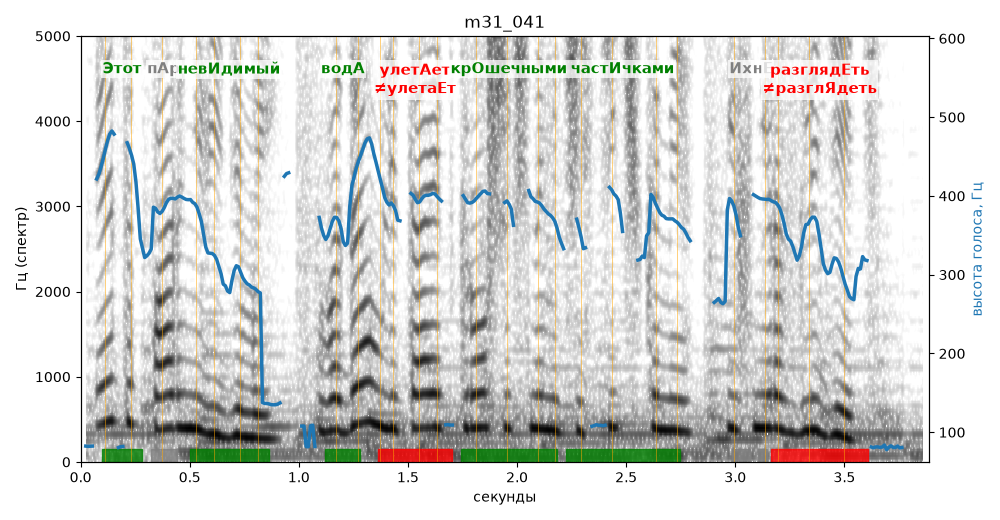

# m31_041

Голос: **Пик (серия 31, 127.0 с)** · длительность 3.9 с
Естественность (UTMOS): **1.27 из 5** (живой диктор ≈ 4–4.5)
Эталон: Этот пар невидимый. Вода улетает крошечными частичками — их не разглядеть.
Распознано: Этот пар невидимый. Вода улетает крошечными частичками и их не разглядеть.
Расхождения в словах: «» → «и»

## Ударения
(где нужно: ruaccent)

| слово | нужно | у голоса | |
|---|---|---|---|
| этот | Этот | Этот | ✓ |
| невидимый | невИдимый | невИдимый | ✓ |
| вода | водА | водА | ✓ |
| улетает | улетАет | улетаЕт | ✗ ОШИБКА |
| крошечными | крОшечными | крОшечными | ✓ |
| частичками | частИчками | частИчками | ✓ |
| разглядеть | разглядЕть | разглЯдеть | ✗ ОШИБКА |

## Интонация
- ✓ «этот пар невидимый.» — конец фразы понижается — звучит законченно
- ✓ «вода улетает крошечными частичками их не разглядеть.» — конец фразы понижается — звучит законченно
- Диапазон голоса 29.3 полутонов (живо), средняя высота 367 Гц

## Паузы и темп
- паузы на своих местах
- Темп 8.7 слога/с (быстро)

_Синяя линия — высота голоса. Над словами заглавная буква — где ударение должно быть; красным — голос поставил не туда (уверенно), оранжевым — возможно._
