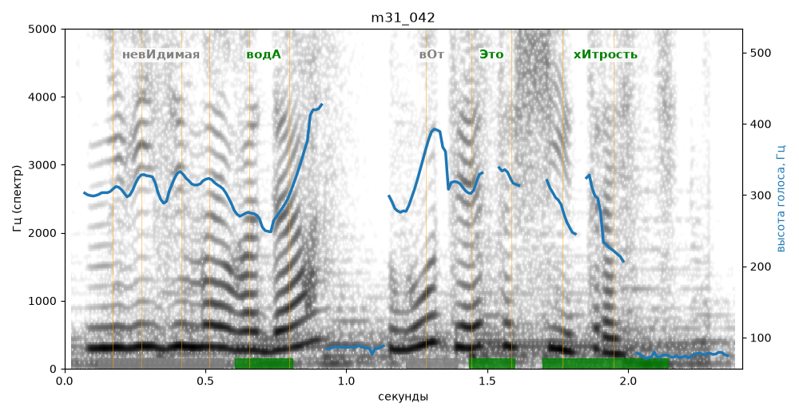

# m31_042

Голос: **Рон (серия 31, 131.0 с)** · длительность 2.4 с
Естественность (UTMOS): **1.41 из 5** (живой диктор ≈ 4–4.5)
Эталон: Невидимая вода? Вот это хитрость!
Распознано: Невидимая вода? Вот эта щитрость.
Расхождения в словах: «это хитрость» → «эта щитрость»

## Ударения
(где нужно: ruaccent)

| слово | нужно | у голоса | |
|---|---|---|---|
| невидимая | невИдимая | — | ? |
| вода | водА | водА | ✓ |
| это | Это | Это | ✓ |
| хитрость | хИтрость | хИтрость | ✓ |

## Интонация
- ✗ «невидимая вода?» — нет вопросительного подъёма (самое высокое место — «вода», в начале) — звучит как утверждение
- ✗ «вот это хитрость!» — восклицание звучит ровно, без эмоции
- Диапазон голоса 28.3 полутонов (живо), средняя высота 296 Гц

## Паузы и темп
- паузы на своих местах
- Темп 6.8 слога/с (быстро)

_Синяя линия — высота голоса. Над словами заглавная буква — где ударение должно быть; красным — голос поставил не туда (уверенно), оранжевым — возможно._
