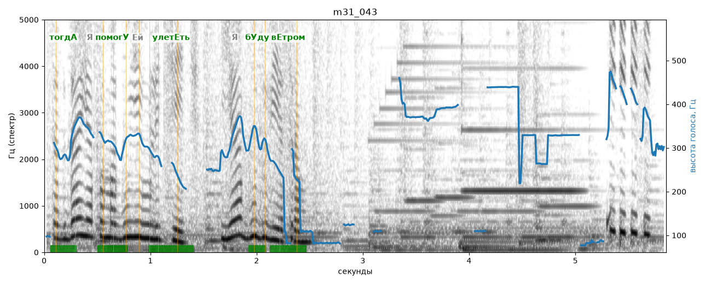

# m31_043

Голос: **Рон (серия 31, 133.5 с)** · длительность 5.9 с
Естественность (UTMOS): **1.29 из 5** (живой диктор ≈ 4–4.5)
Эталон: Тогда я помогу ей улететь. Я буду ветром!
Распознано: Тогда я помогу ей улететь. Я буду ветром.
Слова: все совпали

## Ударения
(где нужно: ruaccent)

| слово | нужно | у голоса | |
|---|---|---|---|
| тогда | тогдА | тогдА | ✓ |
| помогу | помогУ | помогУ | ✓ |
| улететь | улетЕть | улетЕть | ✓ |
| буду | бУду | бУду | ✓ |
| ветром | вЕтром | вЕтром | ✓ |

## Интонация
- ✓ «тогда я помогу ей улететь.» — конец фразы понижается — звучит законченно
- ✓ «я буду ветром!» — выделено слово «буду» (+2.9 пт)
- Диапазон голоса 29.0 полутонов (живо), средняя высота 312 Гц

## Паузы и темп
- паузы на своих местах
- Темп 6.4 слога/с (нормально)

_Синяя линия — высота голоса. Над словами заглавная буква — где ударение должно быть; красным — голос поставил не туда (уверенно), оранжевым — возможно._
