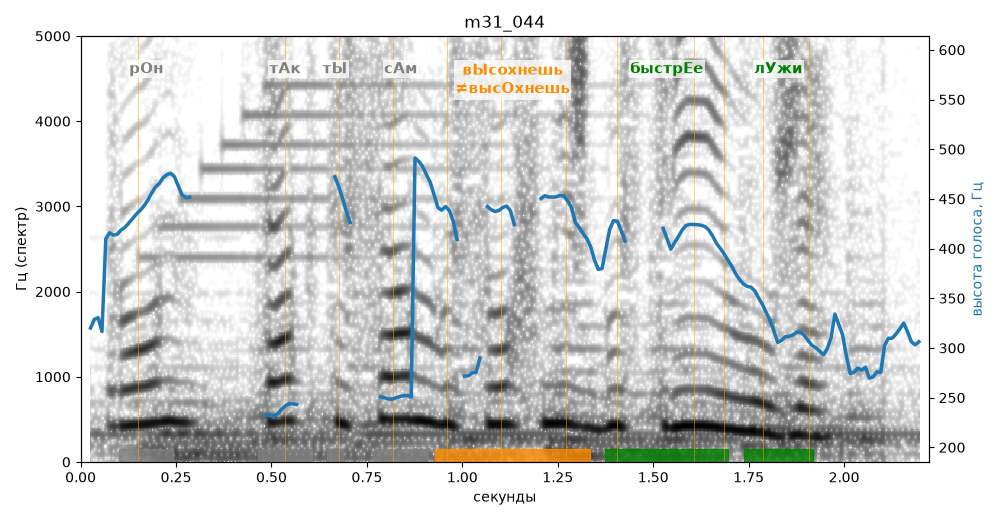

# m31_044

Голос: **Пик (серия 31, 139.5 с)** · длительность 2.2 с
Естественность (UTMOS): **1.28 из 5** (живой диктор ≈ 4–4.5)
Эталон: Рон, так ты сам высохнешь быстрее лужи!
Распознано: Рон, так ты сам высохнешь быстрее уже.
Расхождения в словах: «лужи» → «уже»

## Ударения
(где нужно: ruaccent)

| слово | нужно | у голоса | |
|---|---|---|---|
| высохнешь | вЫсохнешь | высОхнешь | ✗? возможно — послушать |
| быстрее | быстрЕе | быстрЕе | ✓ |
| лужи | лУжи | лУжи | ✓ |

## Интонация
- ✗ «рон так ты сам высохнешь быстрее лужи!» — восклицание звучит ровно, без эмоции
- Диапазон голоса 11.3 полутонов (живо), средняя высота 400 Гц

## Паузы и темп
- паузы на своих местах
- Темп 7.5 слога/с (быстро)

_Синяя линия — высота голоса. Над словами заглавная буква — где ударение должно быть; красным — голос поставил не туда (уверенно), оранжевым — возможно._
