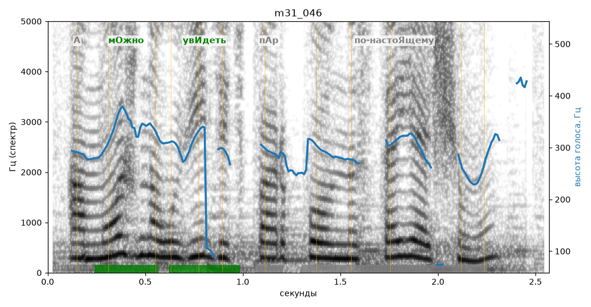

# m31_046

Голос: **Филя (серия 31, 143.3 с)** · длительность 2.6 с
Естественность (UTMOS): **2.3 из 5** (живой диктор ≈ 4–4.5)
Эталон: А можно увидеть пар по-настоящему?
Распознано: А можно увидеть пар полностоящему?
Расхождения в словах: «по-настоящему» → «полностоящему»

## Ударения
(где нужно: ruaccent)

| слово | нужно | у голоса | |
|---|---|---|---|
| можно | мОжно | мОжно | ✓ |
| увидеть | увИдеть | увИдеть | ✓ |
| по-настоящему | по-настоЯщему | — | ? |

## Интонация
- ✗ «а можно увидеть пар по-настоящему?» — нет вопросительного подъёма (самое высокое место — «можно», в начале) — звучит как утверждение
- Диапазон голоса 8.2 полутонов (живо), средняя высота 294 Гц

## Паузы и темп
- паузы на своих местах
- Темп 5.7 слога/с (нормально)

_Синяя линия — высота голоса. Над словами заглавная буква — где ударение должно быть; красным — голос поставил не туда (уверенно), оранжевым — возможно._
