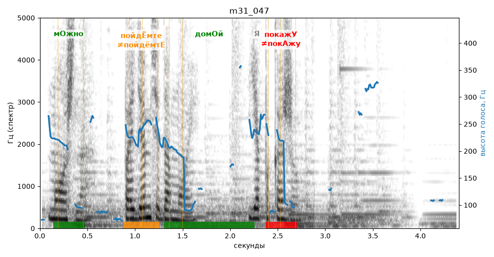

# m31_047

Голос: **Барсик (серия 31, 146.0 с)** · длительность 4.4 с
Естественность (UTMOS): **1.74 из 5** (живой диктор ≈ 4–4.5)
Эталон: Можно. Пойдёмте домой, я покажу.
Распознано: Можно. Пойдемте домой. Я покажу.
Слова: все совпали

## Ударения
(где нужно: ruaccent)

| слово | нужно | у голоса | |
|---|---|---|---|
| можно | мОжно | мОжно | ✓ |
| пойдёмте | пойдЁмте | пойдёмтЕ | ✗? возможно — послушать |
| домой | домОй | домОй | ✓ |
| покажу | покажУ | покАжу | ✗ ОШИБКА |

## Интонация
- ✓ «пойдёмте домой я покажу.» — конец фразы понижается — звучит законченно
- Диапазон голоса 25.0 полутонов (живо), средняя высота 212 Гц

## Паузы и темп
- после «домой,» нет паузы (0.02 с)
- Темп 4.7 слога/с (нормально)

_Синяя линия — высота голоса. Над словами заглавная буква — где ударение должно быть; красным — голос поставил не туда (уверенно), оранжевым — возможно._
