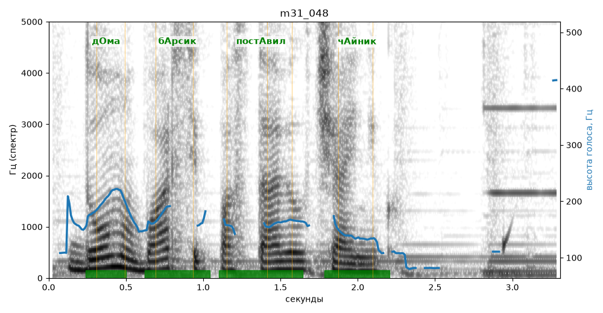

# m31_048

Голос: **Рассказчик (серия 31, 150.5 с)** · длительность 3.3 с
Естественность (UTMOS): **2.95 из 5** (живой диктор ≈ 4–4.5)
Эталон: Дома Барсик поставил чайник.
Распознано: Дома Барсик поставил чайник.
Слова: все совпали

## Ударения
(где нужно: ruaccent)

| слово | нужно | у голоса | |
|---|---|---|---|
| дома | дОма | дОма | ✓ |
| барсик | бАрсик | бАрсик | ✓ |
| поставил | постАвил | постАвил | ✓ |
| чайник | чАйник | чАйник | ✓ |

## Интонация
- ✓ «дома барсик поставил чайник.» — конец фразы понижается — звучит законченно
- Диапазон голоса 16.9 полутонов (живо), средняя высота 157 Гц

## Паузы и темп
- паузы на своих местах
- Темп 4.6 слога/с (нормально)

_Синяя линия — высота голоса. Над словами заглавная буква — где ударение должно быть; красным — голос поставил не туда (уверенно), оранжевым — возможно._
