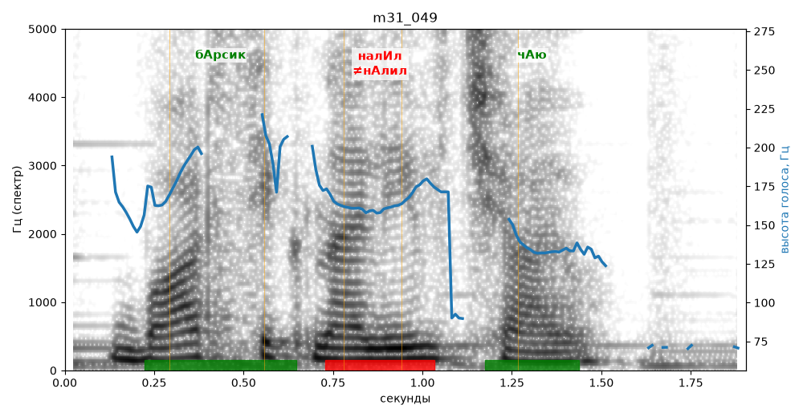

# m31_049

Голос: **Рассказчик (серия 31, 153.9 с)** · длительность 1.9 с
Естественность (UTMOS): **3.62 из 5** (живой диктор ≈ 4–4.5)
Эталон: Барсик налил чаю.
Распознано: Барсик налив чаю.
Расхождения в словах: «налил» → «налив»

## Ударения
(где нужно: ruaccent)

| слово | нужно | у голоса | |
|---|---|---|---|
| барсик | бАрсик | бАрсик | ✓ |
| налил | налИл | нАлил | ✗ ОШИБКА |
| чаю | чАю | чАю | ✓ |

## Интонация
- ✓ «барсик налил чаю.» — конец фразы понижается — звучит законченно
- Диапазон голоса 17.7 полутонов (живо), средняя высота 161 Гц

## Паузы и темп
- паузы на своих местах
- Темп 4.1 слога/с (нормально)

_Синяя линия — высота голоса. Над словами заглавная буква — где ударение должно быть; красным — голос поставил не туда (уверенно), оранжевым — возможно._
