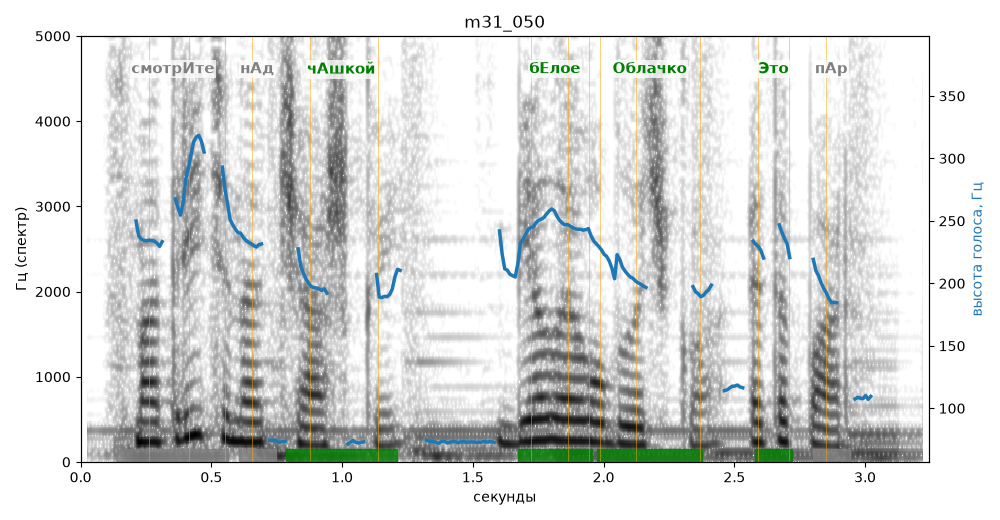

# m31_050

Голос: **Барсик (серия 31, 155.9 с)** · длительность 3.2 с
Естественность (UTMOS): **2.92 из 5** (живой диктор ≈ 4–4.5)
Эталон: Смотрите над чашкой. Белое облачко — это пар.
Распознано: Смотрите над чашкой. Белая облачка – это пар.
Расхождения в словах: «белое облачко» → «белая облачка»

## Ударения
(где нужно: ruaccent)

| слово | нужно | у голоса | |
|---|---|---|---|
| смотрите | смотрИте | смОтрите | ? не разобрать |
| чашкой | чАшкой | чАшкой | ✓ |
| белое | бЕлое | бЕлое | ✓ |
| облачко | Облачко | Облачко | ✓ |
| это | Это | Это | ✓ |

## Интонация
- ✓ «смотрите над чашкой.» — конец фразы понижается — звучит законченно
- ✓ «белое облачко это пар.» — конец фразы понижается — звучит законченно
- Диапазон голоса 22.5 полутонов (живо), средняя высота 207 Гц

## Паузы и темп
- паузы на своих местах
- Темп 7.0 слога/с (быстро)

_Синяя линия — высота голоса. Над словами заглавная буква — где ударение должно быть; красным — голос поставил не туда (уверенно), оранжевым — возможно._
