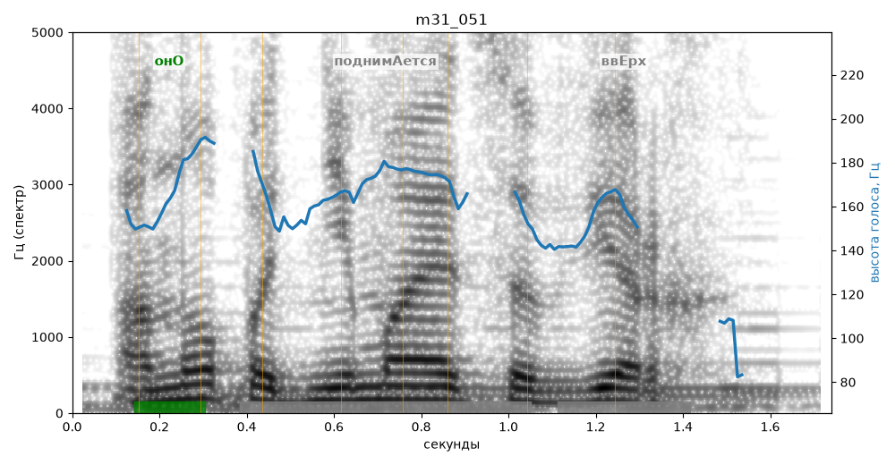

# m31_051

Голос: **Топа (серия 31, 159.3 с)** · длительность 1.7 с
Естественность (UTMOS): **2.74 из 5** (живой диктор ≈ 4–4.5)
Эталон: Оно поднимается вверх!
Распознано: оно поднимается вверх.
Слова: все совпали

## Ударения
(где нужно: ruaccent)

| слово | нужно | у голоса | |
|---|---|---|---|
| оно | онО | онО | ✓ |
| поднимается | поднимАется | поднимаЕтся | ? не разобрать |

## Интонация
- ✓ «оно поднимается вверх!» — выделено слово «оно» (+2.3 пт)
- Диапазон голоса 8.1 полутонов (живо), средняя высота 162 Гц

## Паузы и темп
- паузы на своих местах
- Темп 6.3 слога/с (нормально)

_Синяя линия — высота голоса. Над словами заглавная буква — где ударение должно быть; красным — голос поставил не туда (уверенно), оранжевым — возможно._
