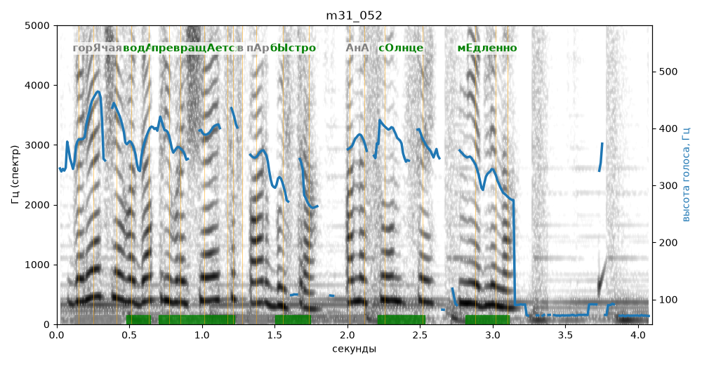

# m31_052

Голос: **Пик (серия 31, 161.2 с)** · длительность 4.1 с
Естественность (UTMOS): **1.27 из 5** (живой диктор ≈ 4–4.5)
Эталон: Горячая вода превращается в пар быстро. А на солнце — медленно.
Распознано: Горячая вода превращается в пар быстро, а на солнце медленно.
Слова: все совпали

## Ударения
(где нужно: ruaccent)

| слово | нужно | у голоса | |
|---|---|---|---|
| горячая | горЯчая | — | ? |
| вода | водА | водА | ✓ |
| превращается | превращАется | превращАется | ✓ |
| быстро | бЫстро | бЫстро | ✓ |
| солнце | сОлнце | сОлнце | ✓ |
| медленно | мЕдленно | мЕдленно | ✓ |

## Интонация
- ✓ «горячая вода превращается в пар быстро.» — конец фразы понижается — звучит законченно
- ✓ «а на солнце медленно.» — конец фразы понижается — звучит законченно
- Диапазон голоса 30.7 полутонов (живо), средняя высота 347 Гц

## Паузы и темп
- паузы на своих местах
- Темп 8.6 слога/с (быстро)

_Синяя линия — высота голоса. Над словами заглавная буква — где ударение должно быть; красным — голос поставил не туда (уверенно), оранжевым — возможно._
