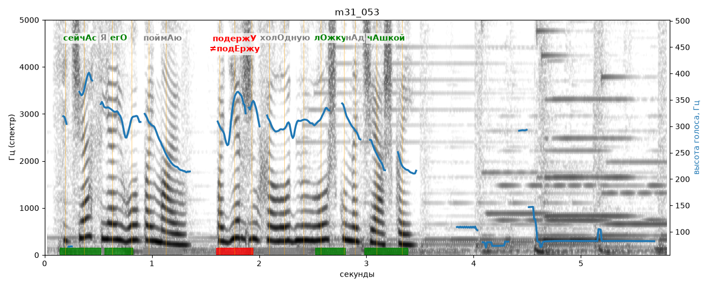

# m31_053

Голос: **Рон (серия 31, 165.4 с)** · длительность 5.8 с
Естественность (UTMOS): **1.71 из 5** (живой диктор ≈ 4–4.5)
Эталон: Сейчас я его поймаю! Подержу холодную ложку над чашкой.
Распознано: Сейчас я его поймаю, поддержив холодную ложку на чашкой.
Расхождения в словах: «подержу» → «поддержив»; «над» → «на»

## Ударения
(где нужно: ruaccent)

| слово | нужно | у голоса | |
|---|---|---|---|
| сейчас | сейчАс | сейчАс | ✓ |
| его | егО | егО | ✓ |
| поймаю | поймАю | — | ? |
| подержу | подержУ | подЕржу | ✗ ОШИБКА |
| холодную | холОдную | — | ? |
| ложку | лОжку | лОжку | ✓ |
| чашкой | чАшкой | чАшкой | ✓ |

## Интонация
- ✓ «сейчас я его поймаю!» — выделено слово «сейчас» (+3.8 пт)
- ✓ «подержу холодную ложку над чашкой.» — конец фразы понижается — звучит законченно
- Диапазон голоса 25.5 полутонов (живо), средняя высота 240 Гц

## Паузы и темп
- паузы на своих местах
- Темп 5.8 слога/с (нормально)

_Синяя линия — высота голоса. Над словами заглавная буква — где ударение должно быть; красным — голос поставил не туда (уверенно), оранжевым — возможно._
