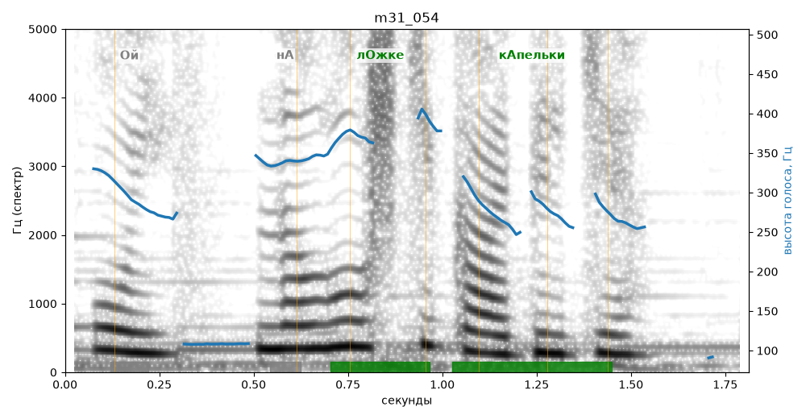

# m31_054

Голос: **Рон (серия 31, 171.3 с)** · длительность 1.8 с
Естественность (UTMOS): **2.37 из 5** (живой диктор ≈ 4–4.5)
Эталон: Ой! На ложке капельки!
Распознано: Ой, на ложке капельки.
Слова: все совпали

## Ударения
(где нужно: ruaccent)

| слово | нужно | у голоса | |
|---|---|---|---|
| ложке | лОжке | лОжке | ✓ |
| капельки | кАпельки | кАпельки | ✓ |

## Интонация
- ✓ «на ложке капельки!» — выделено слово «ложке» (+3.1 пт)
- Диапазон голоса 21.7 полутонов (живо), средняя высота 285 Гц

## Паузы и темп
- паузы на своих местах
- Темп 7.0 слога/с (быстро)

_Синяя линия — высота голоса. Над словами заглавная буква — где ударение должно быть; красным — голос поставил не туда (уверенно), оранжевым — возможно._
