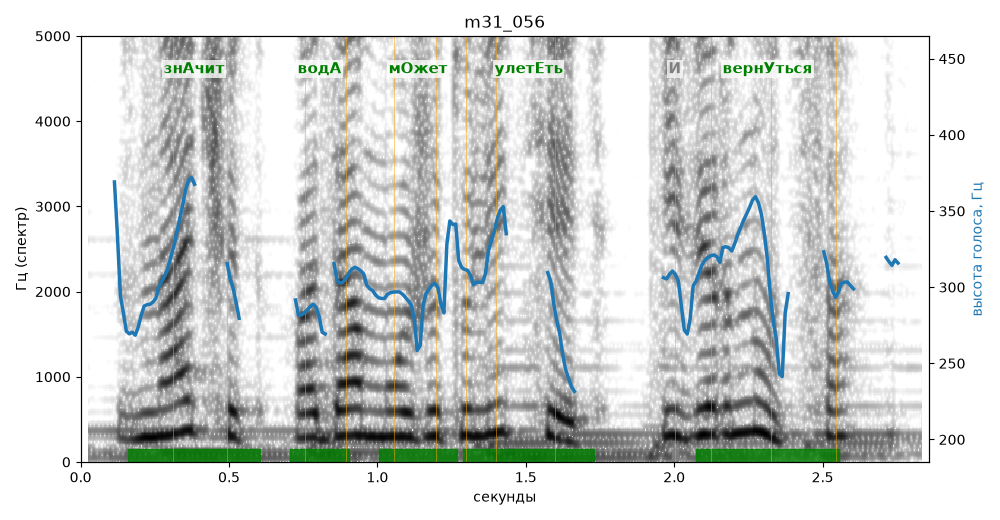

# m31_056

Голос: **Филя (серия 31, 175.9 с)** · длительность 2.9 с
Естественность (UTMOS): **2.2 из 5** (живой диктор ≈ 4–4.5)
Эталон: Значит, вода может улететь — и вернуться?
Распознано: Значит, вода может улететь и вернуться.
Слова: все совпали

## Ударения
(где нужно: ruaccent)

| слово | нужно | у голоса | |
|---|---|---|---|
| значит | знАчит | знАчит | ✓ |
| вода | водА | водА | ✓ |
| может | мОжет | мОжет | ✓ |
| улететь | улетЕть | улетЕть | ✓ |
| вернуться | вернУться | вернУться | ✓ |

## Интонация
- ✗ «значит вода может улететь и вернуться?» — нет вопросительного подъёма (самое высокое место — «вернуться», в начале) — звучит как утверждение
- Диапазон голоса 5.0 полутонов (нормально), средняя высота 303 Гц

## Паузы и темп
- паузы на своих местах
- Темп 6.1 слога/с (нормально)

_Синяя линия — высота голоса. Над словами заглавная буква — где ударение должно быть; красным — голос поставил не туда (уверенно), оранжевым — возможно._
