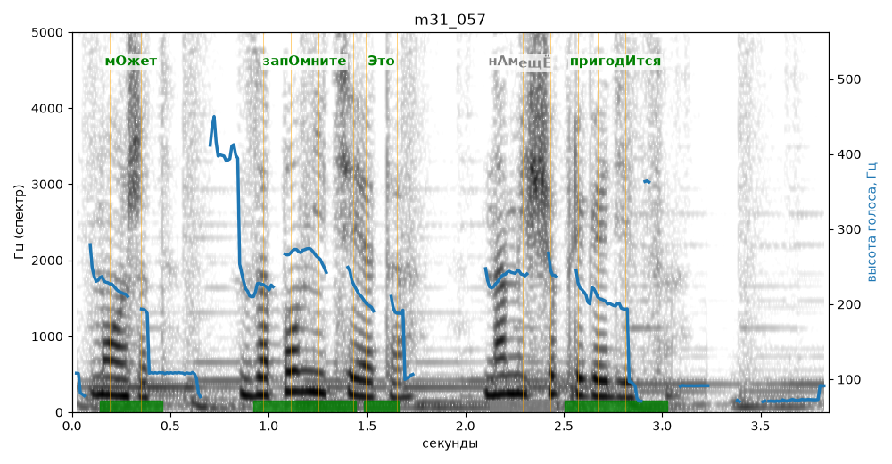

# m31_057

Голос: **Барсик (серия 31, 178.8 с)** · длительность 3.8 с
Естественность (UTMOS): **2.43 из 5** (живой диктор ≈ 4–4.5)
Эталон: Может. Запомните это. Нам ещё пригодится.
Распознано: Может, запомните это, нам ещё пригодится.
Слова: все совпали

## Ударения
(где нужно: ruaccent)

| слово | нужно | у голоса | |
|---|---|---|---|
| может | мОжет | мОжет | ✓ |
| запомните | запОмните | запОмните | ✓ |
| это | Это | Это | ✓ |
| ещё | ещЁ | Ещё | ? не разобрать |
| пригодится | пригодИтся | пригодИтся | ✓ |

## Интонация
- ✓ «запомните это.» — конец фразы понижается — звучит законченно
- ✓ «нам ещё пригодится.» — конец фразы понижается — звучит законченно
- Диапазон голоса 29.6 полутонов (живо), средняя высота 207 Гц

## Паузы и темп
- паузы на своих местах
- Темп 7.6 слога/с (быстро)

_Синяя линия — высота голоса. Над словами заглавная буква — где ударение должно быть; красным — голос поставил не туда (уверенно), оранжевым — возможно._
