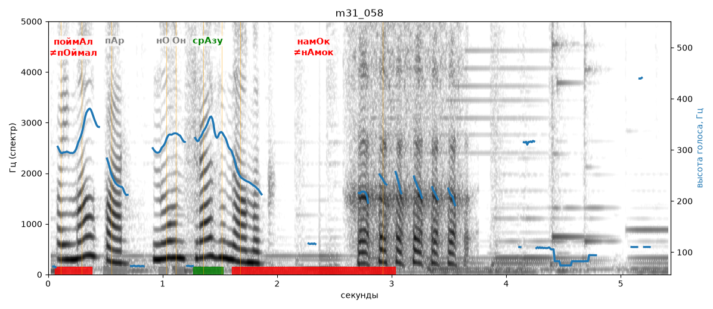

# m31_058

Голос: **Рон (серия 31, 182.8 с)** · длительность 5.4 с
Естественность (UTMOS): **1.55 из 5** (живой диктор ≈ 4–4.5)
Эталон: Поймал пар. Но он сразу намок.
Распознано: Поймал пар, но он сразу намок.
Слова: все совпали

## Ударения
(где нужно: ruaccent)

| слово | нужно | у голоса | |
|---|---|---|---|
| поймал | поймАл | пОймал | ✗ ОШИБКА |
| сразу | срАзу | срАзу | ✓ |
| намок | намОк | нАмок | ✗ ОШИБКА |

## Интонация
- ✓ «поймал пар.» — конец фразы понижается — звучит законченно
- ✓ «но он сразу намок.» — конец фразы понижается — звучит законченно
- Диапазон голоса 27.5 полутонов (живо), средняя высота 234 Гц

## Паузы и темп
- паузы на своих местах
- Темп 3.3 слога/с (медленно)

_Синяя линия — высота голоса. Над словами заглавная буква — где ударение должно быть; красным — голос поставил не туда (уверенно), оранжевым — возможно._
