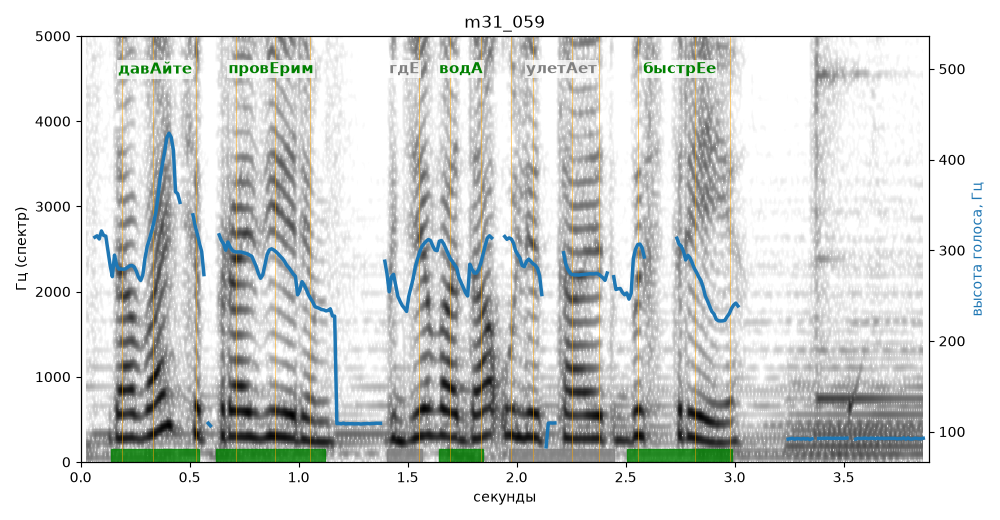

# m31_059

Голос: **Филя (серия 31, 188.4 с)** · длительность 3.9 с
Естественность (UTMOS): **2.46 из 5** (живой диктор ≈ 4–4.5)
Эталон: Давайте проверим, где вода улетает быстрее.
Распознано: Давайте проверим, где вода улетает быстрее.
Слова: все совпали

## Ударения
(где нужно: ruaccent)

| слово | нужно | у голоса | |
|---|---|---|---|
| давайте | давАйте | давАйте | ✓ |
| проверим | провЕрим | провЕрим | ✓ |
| вода | водА | водА | ✓ |
| улетает | улетАет | улЕтает | ? не разобрать |
| быстрее | быстрЕе | быстрЕе | ✓ |

## Интонация
- ✗ «давайте проверим где вода улетает быстрее.» — конец фразы не понижается — звучит незаконченно / как перечисление
- Диапазон голоса 21.6 полутонов (живо), средняя высота 273 Гц

## Паузы и темп
- паузы на своих местах
- Темп 6.2 слога/с (нормально)

_Синяя линия — высота голоса. Над словами заглавная буква — где ударение должно быть; красным — голос поставил не туда (уверенно), оранжевым — возможно._
