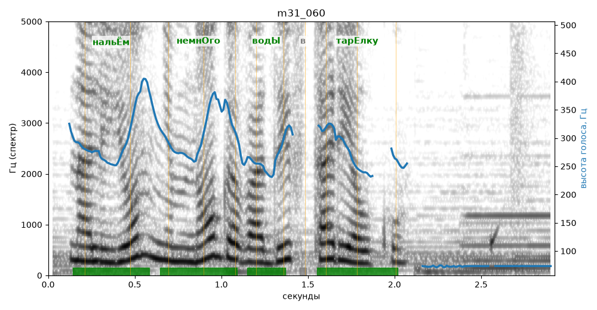

# m31_060

Голос: **Филя (серия 31, 192.4 с)** · длительность 2.9 с
Естественность (UTMOS): **2.17 из 5** (живой диктор ≈ 4–4.5)
Эталон: Нальём немного воды в тарелку.
Распознано: Нальем немного воды в тарелку.
Слова: все совпали

## Ударения
(где нужно: ruaccent)

| слово | нужно | у голоса | |
|---|---|---|---|
| нальём | нальЁм | нальЁм | ✓ |
| немного | немнОго | немнОго | ✓ |
| воды | водЫ | водЫ | ✓ |
| тарелку | тарЕлку | тарЕлку | ✓ |

## Интонация
- ✓ «нальём немного воды в тарелку.» — конец фразы понижается — звучит законченно
- Диапазон голоса 28.1 полутонов (живо), средняя высота 263 Гц

## Паузы и темп
- паузы на своих местах
- Темп 5.9 слога/с (нормально)

_Синяя линия — высота голоса. Над словами заглавная буква — где ударение должно быть; красным — голос поставил не туда (уверенно), оранжевым — возможно._
