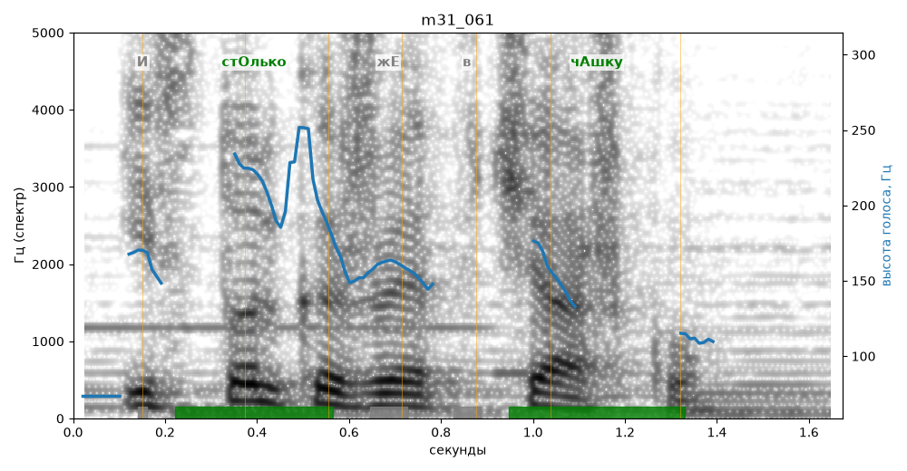

# m31_061

Голос: **Топа (серия 31, 195.4 с)** · длительность 1.7 с
Естественность (UTMOS): **2.74 из 5** (живой диктор ≈ 4–4.5)
Эталон: И столько же — в чашку.
Распознано: и столько же в чашку.
Слова: все совпали

## Ударения
(где нужно: ruaccent)

| слово | нужно | у голоса | |
|---|---|---|---|
| столько | стОлько | стОлько | ✓ |
| чашку | чАшку | чАшку | ✓ |

## Интонация
- ✗ «и столько же в чашку.» — конец фразы не понижается — звучит незаконченно / как перечисление
- Диапазон голоса 19.7 полутонов (живо), средняя высота 159 Гц

## Паузы и темп
- паузы на своих местах
- Темп 5.9 слога/с (нормально)

_Синяя линия — высота голоса. Над словами заглавная буква — где ударение должно быть; красным — голос поставил не туда (уверенно), оранжевым — возможно._
