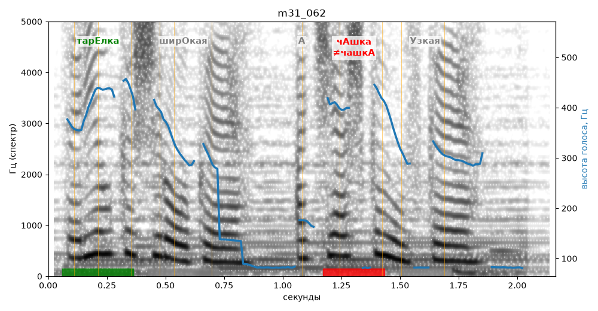

# m31_062

Голос: **Пик (серия 31, 197.2 с)** · длительность 2.2 с
Естественность (UTMOS): **1.31 из 5** (живой диктор ≈ 4–4.5)
Эталон: Тарелка широкая. А чашка узкая.
Распознано: Тариолка широкая, а чашка узкая.
Расхождения в словах: «тарелка» → «тариолка»

## Ударения
(где нужно: ruaccent)

| слово | нужно | у голоса | |
|---|---|---|---|
| тарелка | тарЕлка | тарЕлка | ✓ |
| широкая | ширОкая | — | ? |
| чашка | чАшка | чашкА | ✗ ОШИБКА |
| узкая | Узкая | — | ? |

## Интонация
- ✓ «тарелка широкая.» — конец фразы понижается — звучит законченно
- ✗ «а чашка узкая.» — конец фразы не понижается — звучит незаконченно / как перечисление
- Диапазон голоса 29.0 полутонов (живо), средняя высота 294 Гц

## Паузы и темп
- паузы на своих местах
- Темп 8.4 слога/с (быстро)

_Синяя линия — высота голоса. Над словами заглавная буква — где ударение должно быть; красным — голос поставил не туда (уверенно), оранжевым — возможно._
