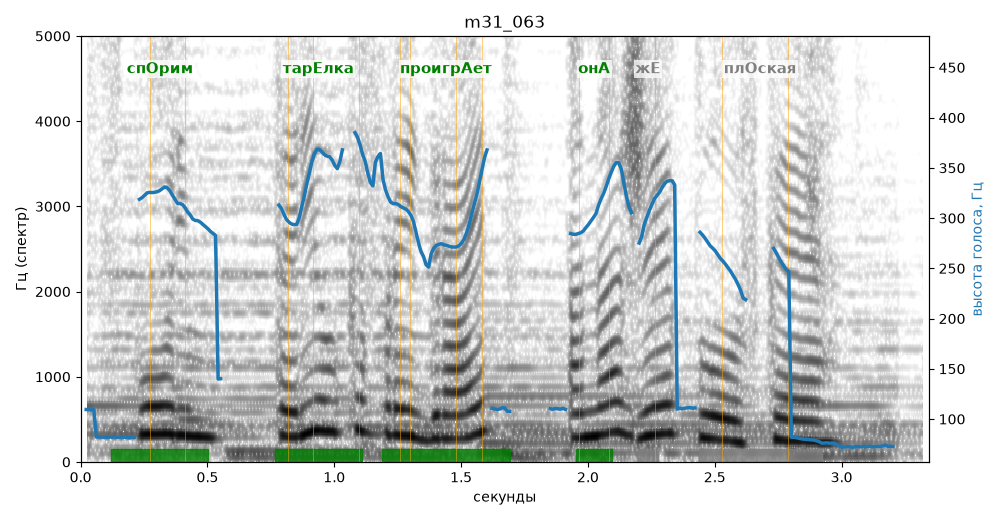

# m31_063

Голос: **Рон (серия 31, 199.5 с)** · длительность 3.3 с
Естественность (UTMOS): **1.6 из 5** (живой диктор ≈ 4–4.5)
Эталон: Спорим, тарелка проиграет? Она же плоская!
Распознано: Вспорим, тарелка проиграет, она же плоская.
Расхождения в словах: «спорим» → «вспорим»

## Ударения
(где нужно: ruaccent)

| слово | нужно | у голоса | |
|---|---|---|---|
| спорим | спОрим | спОрим | ✓ |
| тарелка | тарЕлка | тарЕлка | ✓ |
| проиграет | проигрАет | проигрАет | ✓ |
| она | онА | онА | ✓ |
| плоская | плОская | — | ? |

## Интонация
- ✓ «спорим тарелка проиграет?» — вопросительный подъём на слове «тарелка»
- ✓ «она же плоская!» — выделено слово «она» (+2.7 пт)
- Диапазон голоса 27.7 полутонов (живо), средняя высота 282 Гц

## Паузы и темп
- паузы на своих местах
- Темп 6.6 слога/с (быстро)

_Синяя линия — высота голоса. Над словами заглавная буква — где ударение должно быть; красным — голос поставил не туда (уверенно), оранжевым — возможно._
