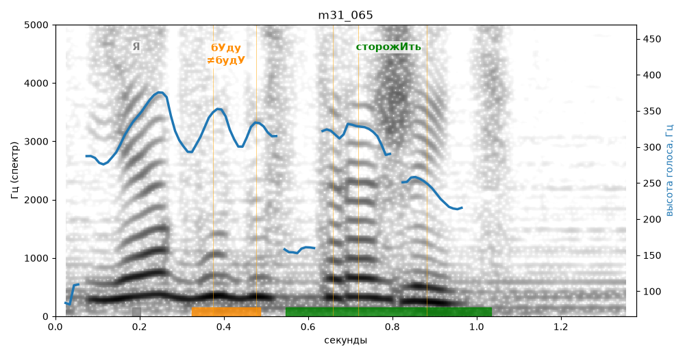

# m31_065

Голос: **Рон (серия 31, 207.0 с)** · длительность 1.4 с
Естественность (UTMOS): **2.24 из 5** (живой диктор ≈ 4–4.5)
Эталон: Я буду сторожить.
Распознано: Я буду строжить.
Расхождения в словах: «сторожить» → «строжить»

## Ударения
(где нужно: ruaccent)

| слово | нужно | у голоса | |
|---|---|---|---|
| буду | бУду | будУ | ✗? возможно — послушать |
| сторожить | сторожИть | сторожИть | ✓ |

## Интонация
- ✓ «я буду сторожить.» — конец фразы понижается — звучит законченно
- Диапазон голоса 14.9 полутонов (живо), средняя высота 306 Гц

## Паузы и темп
- паузы на своих местах
- Темп 5.9 слога/с (нормально)

_Синяя линия — высота голоса. Над словами заглавная буква — где ударение должно быть; красным — голос поставил не туда (уверенно), оранжевым — возможно._
