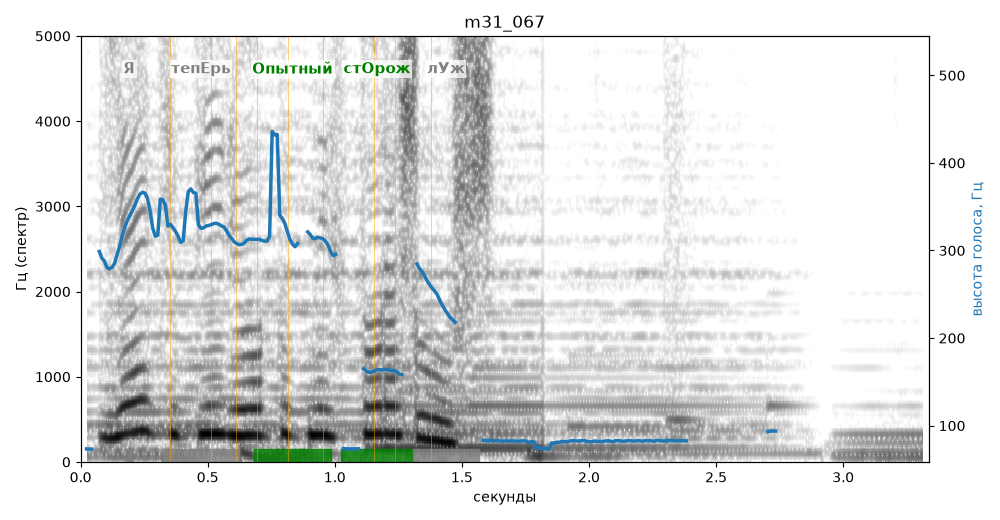

# m31_067

Голос: **Рон (серия 31, 209.4 с)** · длительность 3.3 с
Естественность (UTMOS): **1.42 из 5** (живой диктор ≈ 4–4.5)
Эталон: Я теперь опытный сторож луж.
Распознано: Я теперь опытный сторож уши.
Расхождения в словах: «луж» → «уши»

## Ударения
(где нужно: ruaccent)

| слово | нужно | у голоса | |
|---|---|---|---|
| теперь | тепЕрь | — | ? |
| опытный | Опытный | Опытный | ✓ |
| сторож | стОрож | стОрож | ✓ |

## Интонация
- ✓ «я теперь опытный сторож луж.» — конец фразы понижается — звучит законченно
- Диапазон голоса 27.4 полутонов (живо), средняя высота 164 Гц

## Паузы и темп
- паузы на своих местах
- Темп 6.5 слога/с (нормально)

_Синяя линия — высота голоса. Над словами заглавная буква — где ударение должно быть; красным — голос поставил не туда (уверенно), оранжевым — возможно._
