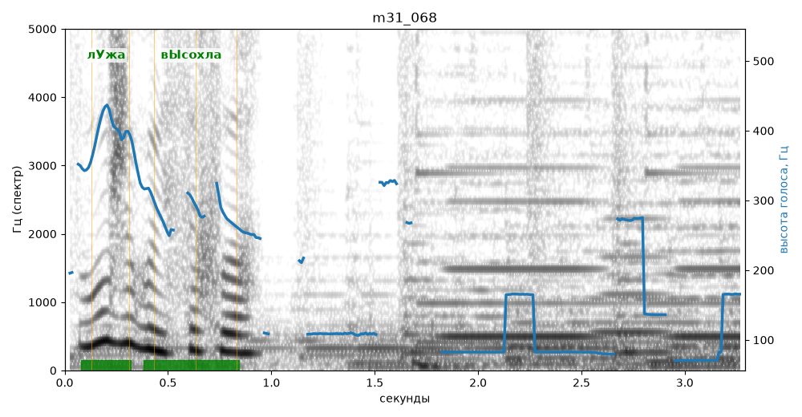

# m31_068

Голос: **Рон (серия 31, 212.9 с)** · длительность 3.3 с
Естественность (UTMOS): **1.27 из 5** (живой диктор ≈ 4–4.5)
Эталон: Лужа высохла!
Распознано: Ужи высохла.
Расхождения в словах: «лужа» → «ужи»

## Ударения
(где нужно: ruaccent)

| слово | нужно | у голоса | |
|---|---|---|---|
| лужа | лУжа | лУжа | ✓ |
| высохла | вЫсохла | вЫсохла | ✓ |

## Интонация
- ✓ «лужа высохла!» — выделено слово «лужа» (+4.2 пт)
- Диапазон голоса 29.7 полутонов (живо), средняя высота 136 Гц

## Паузы и темп
- паузы на своих местах
- Темп 6.6 слога/с (быстро)

_Синяя линия — высота голоса. Над словами заглавная буква — где ударение должно быть; красным — голос поставил не туда (уверенно), оранжевым — возможно._
