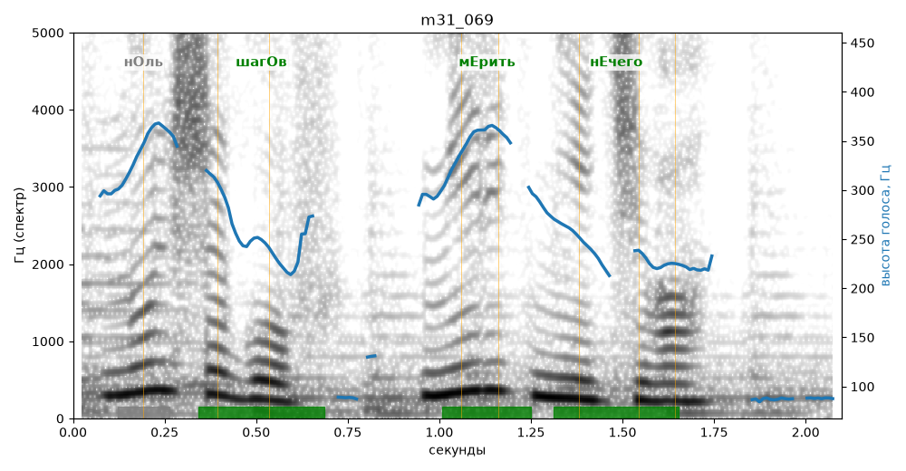

# m31_069

Голос: **Рон (серия 31, 216.3 с)** · длительность 2.1 с
Естественность (UTMOS): **2.23 из 5** (живой диктор ≈ 4–4.5)
Эталон: Ноль шагов! Мерить нечего.
Распознано: Ноль шагов, мерить нечего.
Слова: все совпали

## Ударения
(где нужно: ruaccent)

| слово | нужно | у голоса | |
|---|---|---|---|
| шагов | шагОв | шагОв | ✓ |
| мерить | мЕрить | мЕрить | ✓ |
| нечего | нЕчего | нЕчего | ✓ |

## Интонация
- ✓ «ноль шагов!» — выделено слово «ноль» (+2.7 пт)
- ✗ «мерить нечего.» — конец фразы не понижается — звучит незаконченно / как перечисление
- Диапазон голоса 24.6 полутонов (живо), средняя высота 251 Гц

## Паузы и темп
- паузы на своих местах
- Темп 6.6 слога/с (быстро)

_Синяя линия — высота голоса. Над словами заглавная буква — где ударение должно быть; красным — голос поставил не туда (уверенно), оранжевым — возможно._
