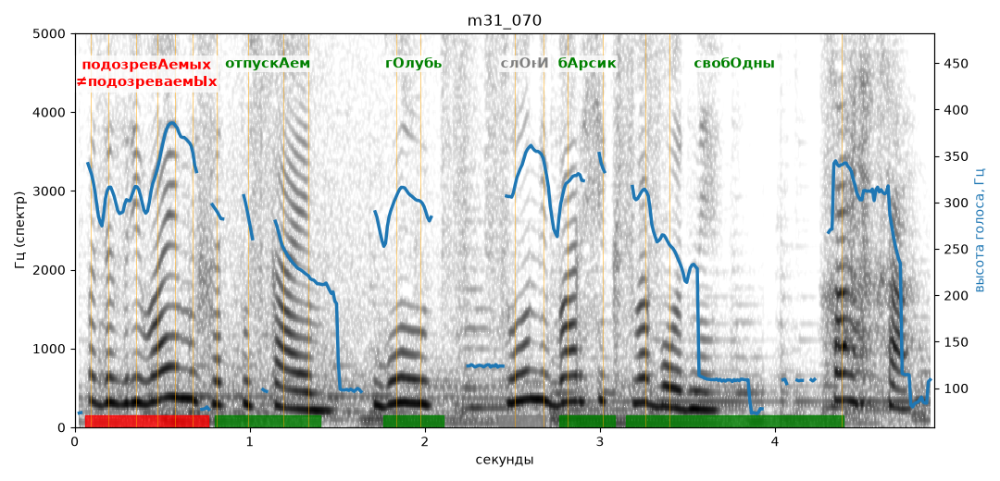

# m31_070

Голос: **Рон (серия 31, 218.5 с)** · длительность 4.9 с
Естественность (UTMOS): **1.46 из 5** (живой диктор ≈ 4–4.5)
Эталон: Подозреваемых отпускаем. Голубь, слон и Барсик свободны!
Распознано: Подозреваемых отпускаем. Голд, слон и барсик свободны. Ха-ха!
Расхождения в словах: «голубь» → «голд»; «» → «ха-ха»

## Ударения
(где нужно: ruaccent)

| слово | нужно | у голоса | |
|---|---|---|---|
| подозреваемых | подозревАемых | подозреваемЫх | ✗ ОШИБКА |
| отпускаем | отпускАем | отпускАем | ✓ |
| голубь | гОлубь | гОлубь | ✓ |
| барсик | бАрсик | бАрсик | ✓ |
| свободны | свобОдны | свобОдны | ✓ |

## Интонация
- ✓ «подозреваемых отпускаем.» — конец фразы понижается — звучит законченно
- ✓ «голубь слон и барсик свободны!» — выделено слово «и» (+2.0 пт)
- Диапазон голоса 25.0 полутонов (живо), средняя высота 277 Гц

## Паузы и темп
- паузы на своих местах
- Темп 5.2 слога/с (нормально)

_Синяя линия — высота голоса. Над словами заглавная буква — где ударение должно быть; красным — голос поставил не туда (уверенно), оранжевым — возможно._
