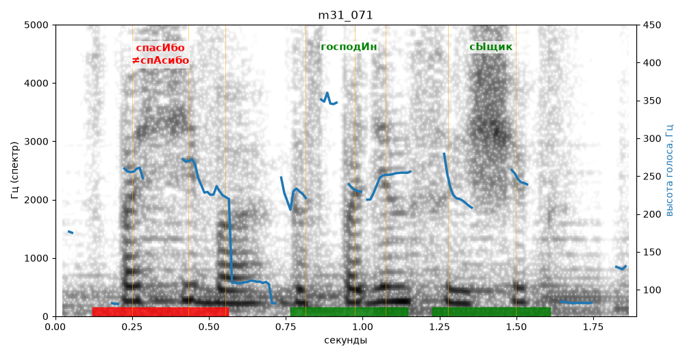

# m31_071

Голос: **Барсик (серия 31, 223.5 с)** · длительность 1.9 с
Естественность (UTMOS): **2.76 из 5** (живой диктор ≈ 4–4.5)
Эталон: Спасибо, господин сыщик.
Распознано: Спасибо, господин сыщик.
Слова: все совпали

## Ударения
(где нужно: ruaccent)

| слово | нужно | у голоса | |
|---|---|---|---|
| спасибо | спасИбо | спАсибо | ✗ ОШИБКА |
| господин | господИн | господИн | ✓ |
| сыщик | сЫщик | сЫщик | ✓ |

## Интонация
- ✓ «спасибо господин сыщик.» — конец фразы понижается — звучит законченно
- Диапазон голоса 23.4 полутонов (живо), средняя высота 228 Гц

## Паузы и темп
- паузы на своих местах
- Темп 6.2 слога/с (нормально)

_Синяя линия — высота голоса. Над словами заглавная буква — где ударение должно быть; красным — голос поставил не туда (уверенно), оранжевым — возможно._
