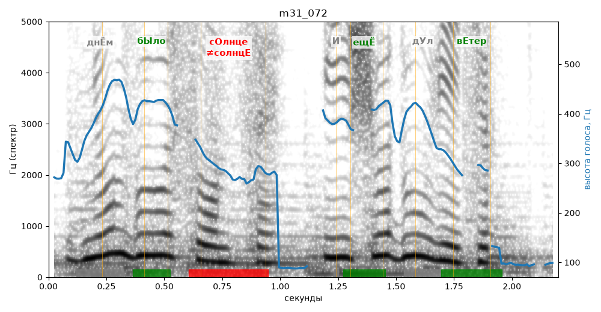

# m31_072

Голос: **Пик (серия 31, 225.5 с)** · длительность 2.2 с
Естественность (UTMOS): **1.26 из 5** (живой диктор ≈ 4–4.5)
Эталон: Днём было солнце. И ещё дул ветер.
Распознано: Днем было солнце, и еще двумедель.
Расхождения в словах: «дул ветер» → «двумедель»

## Ударения
(где нужно: ruaccent)

| слово | нужно | у голоса | |
|---|---|---|---|
| было | бЫло | бЫло | ✓ |
| солнце | сОлнце | солнцЕ | ✗ ОШИБКА |
| ещё | ещЁ | ещЁ | ✓ |
| ветер | вЕтер | вЕтер | ✓ |

## Интонация
- ✓ «днём было солнце.» — конец фразы понижается — звучит законченно
- ✓ «и ещё дул ветер.» — конец фразы понижается — звучит законченно
- Диапазон голоса 27.3 полутонов (живо), средняя высота 328 Гц

## Паузы и темп
- паузы на своих местах
- Темп 7.1 слога/с (быстро)

_Синяя линия — высота голоса. Над словами заглавная буква — где ударение должно быть; красным — голос поставил не туда (уверенно), оранжевым — возможно._
