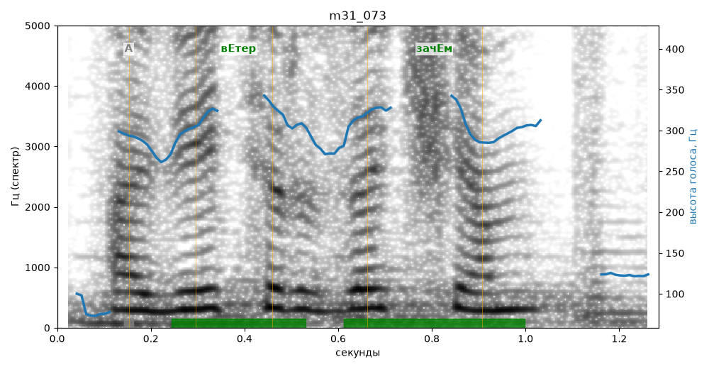

# m31_073

Голос: **Филя (серия 31, 227.9 с)** · длительность 1.3 с
Естественность (UTMOS): **2.7 из 5** (живой диктор ≈ 4–4.5)
Эталон: А ветер зачем?
Распознано: А ветер зачем?
Слова: все совпали

## Ударения
(где нужно: ruaccent)

| слово | нужно | у голоса | |
|---|---|---|---|
| ветер | вЕтер | вЕтер | ✓ |
| зачем | зачЕм | зачЕм | ✓ |

## Интонация
- ✗ «а ветер зачем?» — нет вопросительного подъёма (самое высокое место — «ветер», в начале) — звучит как утверждение
- Диапазон голоса 25.3 полутонов (живо), средняя высота 294 Гц

## Паузы и темп
- паузы на своих местах
- Темп 5.8 слога/с (нормально)

_Синяя линия — высота голоса. Над словами заглавная буква — где ударение должно быть; красным — голос поставил не туда (уверенно), оранжевым — возможно._
