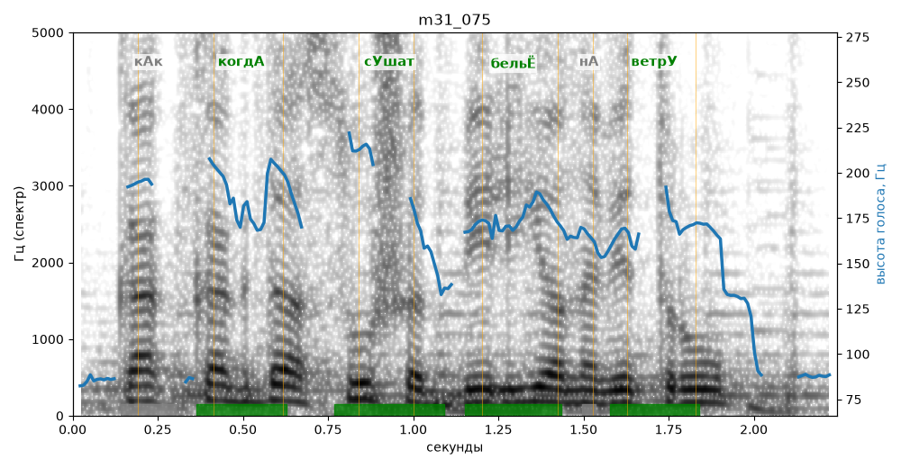

# m31_075

Голос: **Топа (серия 31, 232.6 с)** · длительность 2.2 с
Естественность (UTMOS): **2.12 из 5** (живой диктор ≈ 4–4.5)
Эталон: Как когда сушат бельё на ветру?
Распознано: Как когда сушат белье на ветру?
Слова: все совпали

## Ударения
(где нужно: ruaccent)

| слово | нужно | у голоса | |
|---|---|---|---|
| когда | когдА | когдА | ✓ |
| сушат | сУшат | сУшат | ✓ |
| бельё | бельЁ | бельЁ | ✓ |
| ветру | ветрУ | ветрУ | ✓ |

## Интонация
- ✗ «как когда сушат бельё на ветру?» — конец фразы не понижается — звучит незаконченно / как перечисление
- Диапазон голоса 15.2 полутонов (живо), средняя высота 169 Гц

## Паузы и темп
- паузы на своих местах
- Темп 5.9 слога/с (нормально)

_Синяя линия — высота голоса. Над словами заглавная буква — где ударение должно быть; красным — голос поставил не туда (уверенно), оранжевым — возможно._
