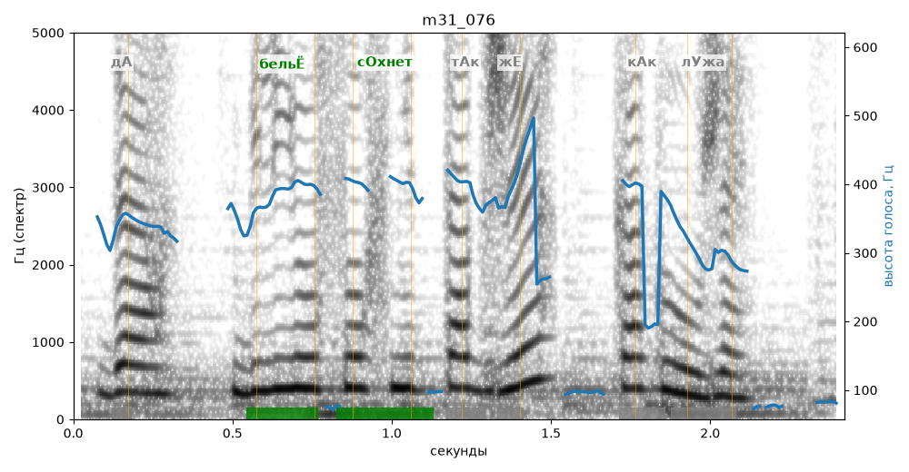

# m31_076

Голос: **Пик (серия 31, 234.9 с)** · длительность 2.4 с
Естественность (UTMOS): **1.3 из 5** (живой диктор ≈ 4–4.5)
Эталон: Да. Бельё сохнет так же, как лужа.
Распознано: Да, билиусов нет также? Как уже?
Расхождения в словах: «белье сохнет так же» → «билиусов нет также»; «лужа» → «уже»

## Ударения
(где нужно: ruaccent)

| слово | нужно | у голоса | |
|---|---|---|---|
| бельё | бельЁ | бельЁ | ✓ |
| сохнет | сОхнет | сОхнет | ✓ |
| лужа | лУжа | лужА | ? не разобрать |

## Интонация
- ✓ «бельё сохнет так же как лужа.» — конец фразы понижается — звучит законченно
- Диапазон голоса 29.1 полутонов (живо), средняя высота 346 Гц

## Паузы и темп
- паузы на своих местах
- Темп 7.7 слога/с (быстро)

_Синяя линия — высота голоса. Над словами заглавная буква — где ударение должно быть; красным — голос поставил не туда (уверенно), оранжевым — возможно._
