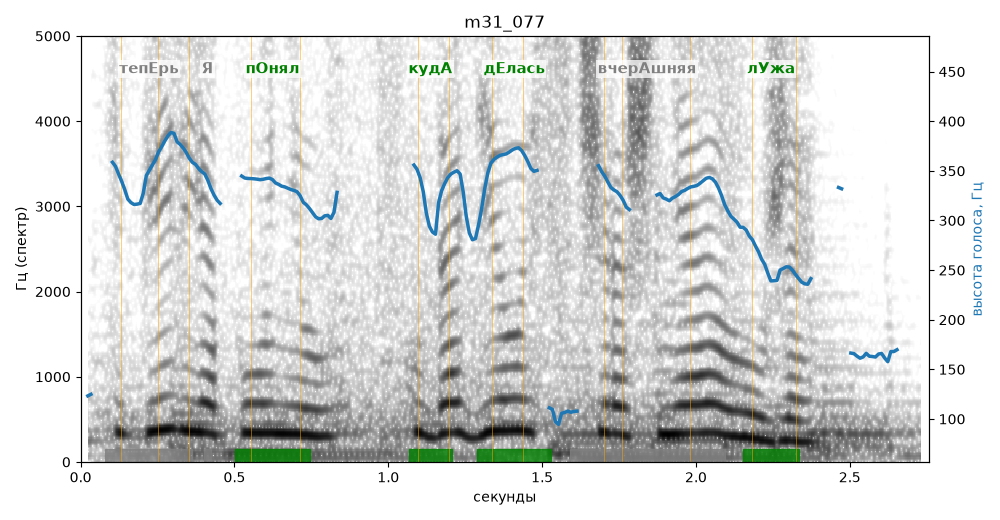

# m31_077

Голос: **Рон (серия 31, 237.5 с)** · длительность 2.8 с
Естественность (UTMOS): **1.35 из 5** (живой диктор ≈ 4–4.5)
Эталон: Теперь я понял, куда делась вчерашняя лужа.
Распознано: Теперь я понял, куда делась чарашня уже.
Расхождения в словах: «вчерашняя лужа» → «чарашня уже»

## Ударения
(где нужно: ruaccent)

| слово | нужно | у голоса | |
|---|---|---|---|
| теперь | тепЕрь | — | ? |
| понял | пОнял | пОнял | ✓ |
| куда | кудА | кудА | ✓ |
| делась | дЕлась | дЕлась | ✓ |
| вчерашняя | вчерАшняя | — | ? |
| лужа | лУжа | лУжа | ✓ |

## Интонация
- ✓ «теперь я понял куда делась вчерашняя лужа.» — конец фразы понижается — звучит законченно
- Диапазон голоса 20.8 полутонов (живо), средняя высота 327 Гц

## Паузы и темп
- паузы на своих местах
- Темп 7.2 слога/с (быстро)

_Синяя линия — высота голоса. Над словами заглавная буква — где ударение должно быть; красным — голос поставил не туда (уверенно), оранжевым — возможно._
