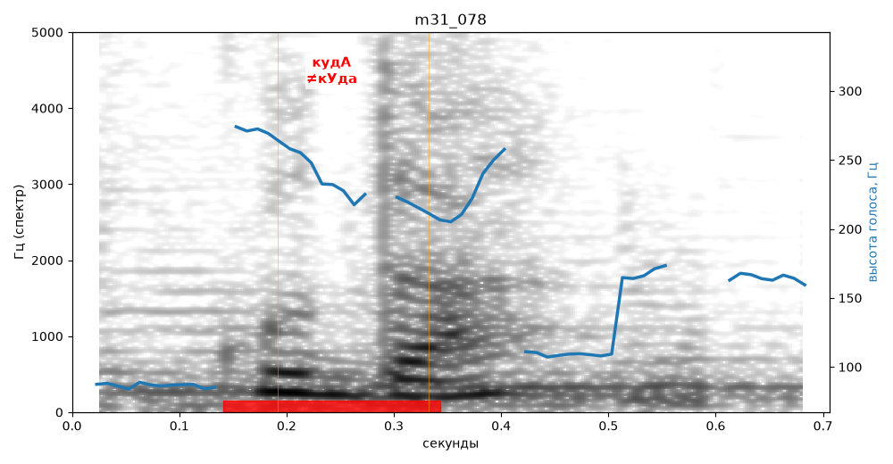

# m31_078

Голос: **Барсик (серия 31, 240.3 с)** · длительность 0.7 с
Естественность (UTMOS): **1.8 из 5** (живой диктор ≈ 4–4.5)
Эталон: Куда?
Распознано: Куда?
Слова: все совпали

## Ударения
(где нужно: ruaccent)

| слово | нужно | у голоса | |
|---|---|---|---|
| куда | кудА | кУда | ✗ ОШИБКА |

## Интонация
- Диапазон голоса 19.8 полутонов (живо), средняя высота 166 Гц

## Паузы и темп
- паузы на своих местах
- Темп 9.9 слога/с (быстро)

_Синяя линия — высота голоса. Над словами заглавная буква — где ударение должно быть; красным — голос поставил не туда (уверенно), оранжевым — возможно._
