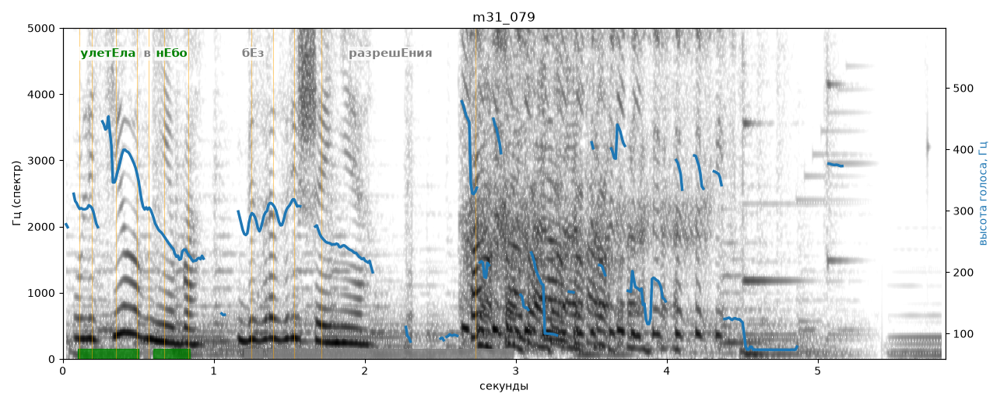

# m31_079

Голос: **Рон (серия 31, 241.2 с)** · длительность 5.8 с
Естественность (UTMOS): **1.24 из 5** (живой диктор ≈ 4–4.5)
Эталон: Улетела в небо. Без разрешения!
Распознано: Улетела в небо без разрешения.
Слова: все совпали

## Ударения
(где нужно: ruaccent)

| слово | нужно | у голоса | |
|---|---|---|---|
| улетела | улетЕла | улетЕла | ✓ |
| небо | нЕбо | нЕбо | ✓ |
| разрешения | разрешЕния | — | ? |

## Интонация
- ✓ «улетела в небо.» — конец фразы понижается — звучит законченно
- ✗ «без разрешения!» — восклицание звучит ровно, без эмоции
- Диапазон голоса 30.3 полутонов (живо), средняя высота 244 Гц

## Паузы и темп
- паузы на своих местах
- Темп 4.8 слога/с (нормально)

_Синяя линия — высота голоса. Над словами заглавная буква — где ударение должно быть; красным — голос поставил не туда (уверенно), оранжевым — возможно._
