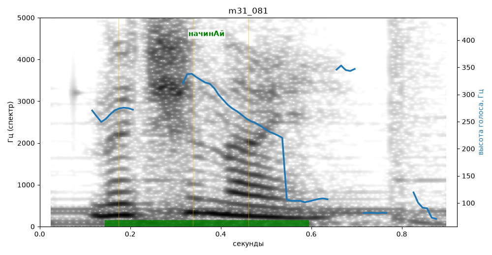

# m31_081

Голос: **Барсик (серия 31, 250.8 с)** · длительность 0.9 с
Естественность (UTMOS): **3.02 из 5** (живой диктор ≈ 4–4.5)
Эталон: Начинай!
Распознано: Начинай!
Слова: все совпали

## Ударения
(где нужно: ruaccent)

| слово | нужно | у голоса | |
|---|---|---|---|
| начинай | начинАй | начинАй | ✓ |

## Интонация
- ✗ «начинай!» — восклицание звучит ровно, без эмоции
- Диапазон голоса 25.0 полутонов (живо), средняя высота 250 Гц

## Паузы и темп
- паузы на своих местах
- Темп 6.7 слога/с (быстро)

_Синяя линия — высота голоса. Над словами заглавная буква — где ударение должно быть; красным — голос поставил не туда (уверенно), оранжевым — возможно._
