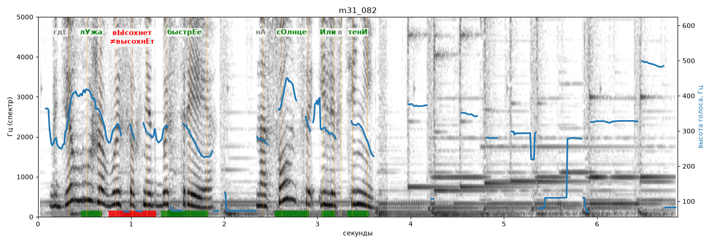

# m31_082

Голос: **Филя (серия 31, 251.9 с)** · длительность 6.9 с
Естественность (UTMOS): **1.61 из 5** (живой диктор ≈ 4–4.5)
Эталон: Где лужа высохнет быстрее: на солнце или в тени?
Распознано: Где лужа высохнет быстрее? На солнце или в тени?
Слова: все совпали

## Ударения
(где нужно: ruaccent)

| слово | нужно | у голоса | |
|---|---|---|---|
| лужа | лУжа | лУжа | ✓ |
| высохнет | вЫсохнет | высохнЕт | ✗ ОШИБКА |
| быстрее | быстрЕе | быстрЕе | ✓ |
| солнце | сОлнце | сОлнце | ✓ |
| или | Или | Или | ✓ |
| тени | тенИ | тенИ | ✓ |

## Интонация
- ✓ «где лужа высохнет быстрее на солнце или в тени?» — конец фразы понижается — звучит законченно
- Диапазон голоса 31.3 полутонов (живо), средняя высота 294 Гц

## Паузы и темп
- паузы на своих местах
- Темп 5.9 слога/с (нормально)

_Синяя линия — высота голоса. Над словами заглавная буква — где ударение должно быть; красным — голос поставил не туда (уверенно), оранжевым — возможно._
