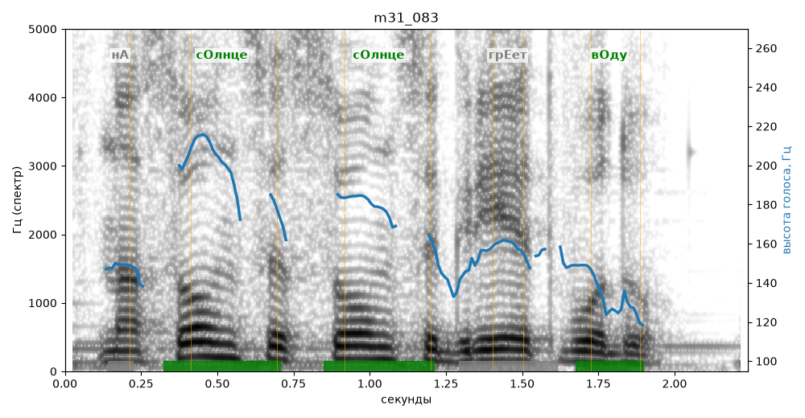

# m31_083

Голос: **Топа (серия 31, 258.9 с)** · длительность 2.2 с
Естественность (UTMOS): **3.49 из 5** (живой диктор ≈ 4–4.5)
Эталон: На солнце! Солнце греет воду.
Распознано: На солнце солнце греет воду.
Слова: все совпали

## Ударения
(где нужно: ruaccent)

| слово | нужно | у голоса | |
|---|---|---|---|
| солнце | сОлнце | сОлнце | ✓ |
| солнце | сОлнце | сОлнце | ✓ |
| греет | грЕет | греЕт | ? не разобрать |
| воду | вОду | вОду | ✓ |

## Интонация
- ✓ «на солнце!» — выделено слово «солнце» (+2.8 пт)
- ✓ «солнце греет воду.» — конец фразы понижается — звучит законченно
- Диапазон голоса 8.8 полутонов (живо), средняя высота 157 Гц

## Паузы и темп
- после «солнце!» пауза всего 0.14 с — фразы слипаются
- Темп 5.1 слога/с (нормально)

_Синяя линия — высота голоса. Над словами заглавная буква — где ударение должно быть; красным — голос поставил не туда (уверенно), оранжевым — возможно._
