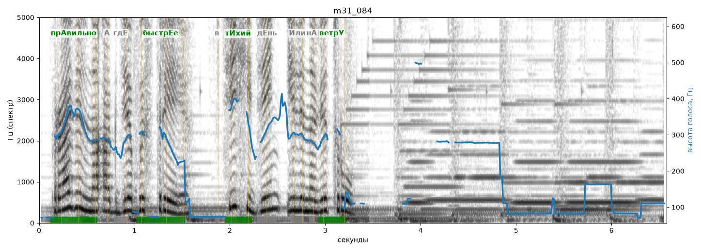

# m31_084

Голос: **Филя (серия 31, 261.2 с)** · длительность 6.6 с
Естественность (UTMOS): **1.48 из 5** (живой диктор ≈ 4–4.5)
Эталон: Правильно! А где быстрее: в тихий день или на ветру?
Распознано: Правильно, а где быстрее? В тихий день или на ветру?
Слова: все совпали

## Ударения
(где нужно: ruaccent)

| слово | нужно | у голоса | |
|---|---|---|---|
| правильно | прАвильно | прАвильно | ✓ |
| быстрее | быстрЕе | быстрЕе | ✓ |
| тихий | тИхий | тИхий | ✓ |
| или | Или | илИ | ? не разобрать |
| ветру | ветрУ | ветрУ | ✓ |

## Интонация
- ✗ «правильно!» — восклицание звучит ровно, без эмоции
- ✓ «а где быстрее в тихий день или на ветру?» — вопросительный подъём на слове «тихий»
- Диапазон голоса 28.1 полутонов (живо), средняя высота 226 Гц

## Паузы и темп
- после «правильно!» пауза всего 0.10 с — фразы слипаются
- Темп 6.5 слога/с (нормально)

_Синяя линия — высота голоса. Над словами заглавная буква — где ударение должно быть; красным — голос поставил не туда (уверенно), оранжевым — возможно._
