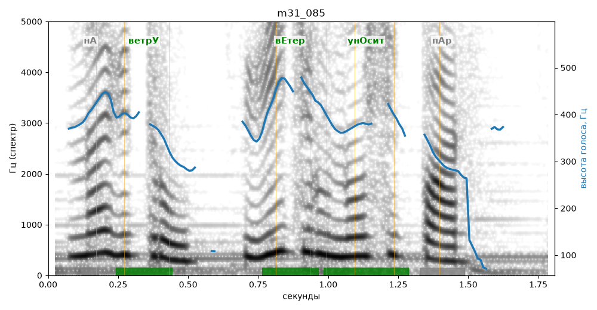

# m31_085

Голос: **Пик (серия 31, 267.9 с)** · длительность 1.8 с
Естественность (UTMOS): **1.56 из 5** (живой диктор ≈ 4–4.5)
Эталон: На ветру. Ветер уносит пар.
Распознано: На ветру ветер уносит пар.
Слова: все совпали

## Ударения
(где нужно: ruaccent)

| слово | нужно | у голоса | |
|---|---|---|---|
| ветру | ветрУ | ветрУ | ✓ |
| ветер | вЕтер | вЕтер | ✓ |
| уносит | унОсит | унОсит | ✓ |

## Интонация
- ✓ «на ветру.» — конец фразы понижается — звучит законченно
- ✓ «ветер уносит пар.» — конец фразы понижается — звучит законченно
- Диапазон голоса 24.6 полутонов (живо), средняя высота 373 Гц

## Паузы и темп
- паузы на своих местах
- Темп 8.6 слога/с (быстро)

_Синяя линия — высота голоса. Над словами заглавная буква — где ударение должно быть; красным — голос поставил не туда (уверенно), оранжевым — возможно._
