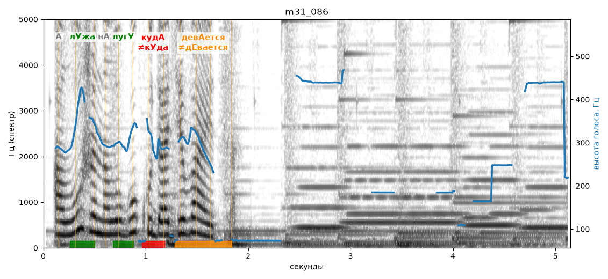

# m31_086

Голос: **Филя (серия 31, 269.8 с)** · длительность 5.1 с
Естественность (UTMOS): **1.43 из 5** (живой диктор ≈ 4–4.5)
Эталон: А лужа на лугу куда девается?
Распознано: А лужа на лугу куда девается?
Слова: все совпали

## Ударения
(где нужно: ruaccent)

| слово | нужно | у голоса | |
|---|---|---|---|
| лужа | лУжа | лУжа | ✓ |
| лугу | лугУ | лугУ | ✓ |
| куда | кудА | кУда | ✗ ОШИБКА |
| девается | девАется | дЕвается | ✗? возможно — послушать |

## Интонация
- ✗ «а лужа на лугу куда девается?» — нет вопросительного подъёма (самое высокое место — «лужа», в начале) — звучит как утверждение
- Диапазон голоса 31.2 полутонов (живо), средняя высота 286 Гц

## Паузы и темп
- паузы на своих местах
- Темп 7.1 слога/с (быстро)

_Синяя линия — высота голоса. Над словами заглавная буква — где ударение должно быть; красным — голос поставил не туда (уверенно), оранжевым — возможно._
