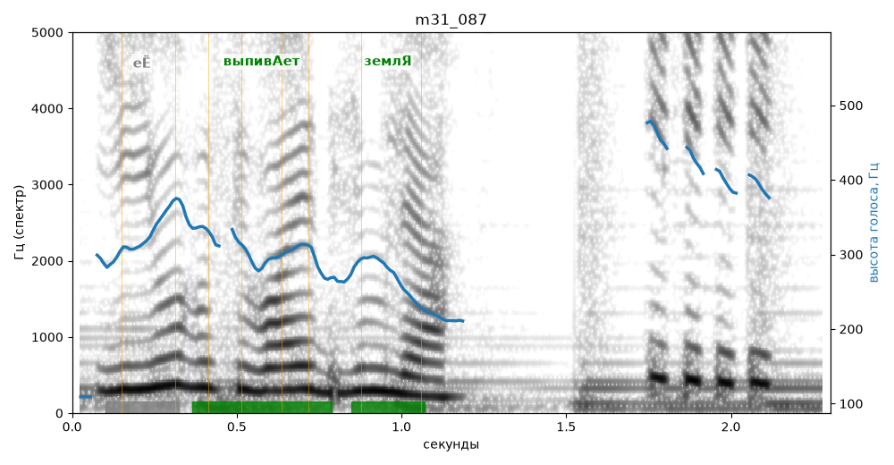

# m31_087

Голос: **Рон (серия 31, 275.1 с)** · длительность 2.3 с
Естественность (UTMOS): **1.43 из 5** (живой диктор ≈ 4–4.5)
Эталон: Её выпивает земля!
Распознано: Её выпивает земля Хи-хи-хи-хи
Расхождения в словах: «» → «хи-хи-хи-хи»

## Ударения
(где нужно: ruaccent)

| слово | нужно | у голоса | |
|---|---|---|---|
| её | еЁ | Её | ? не разобрать |
| выпивает | выпивАет | выпивАет | ✓ |
| земля | землЯ | землЯ | ✓ |

## Интонация
- ✓ «её выпивает земля!» — выделено слово «её» (+2.8 пт)
- Диапазон голоса 12.8 полутонов (живо), средняя высота 305 Гц

## Паузы и темп
- паузы на своих местах
- Темп 8.3 слога/с (быстро)

_Синяя линия — высота голоса. Над словами заглавная буква — где ударение должно быть; красным — голос поставил не туда (уверенно), оранжевым — возможно._
