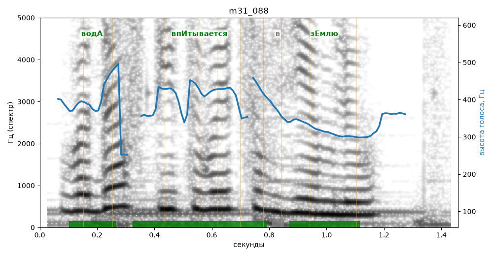

# m31_088

Голос: **Пик (серия 31, 277.5 с)** · длительность 1.5 с
Естественность (UTMOS): **1.44 из 5** (живой диктор ≈ 4–4.5)
Эталон: Вода впитывается в землю.
Распознано: Вода спитывается в землю.
Расхождения в словах: «впитывается» → «спитывается»

## Ударения
(где нужно: ruaccent)

| слово | нужно | у голоса | |
|---|---|---|---|
| вода | водА | водА | ✓ |
| впитывается | впИтывается | впИтывается | ✓ |
| землю | зЕмлю | зЕмлю | ✓ |

## Интонация
- ✓ «вода впитывается в землю.» — конец фразы понижается — звучит законченно
- Диапазон голоса 7.2 полутонов (живо), средняя высота 364 Гц

## Паузы и темп
- паузы на своих местах
- Темп 9.9 слога/с (быстро)

_Синяя линия — высота голоса. Над словами заглавная буква — где ударение должно быть; красным — голос поставил не туда (уверенно), оранжевым — возможно._
