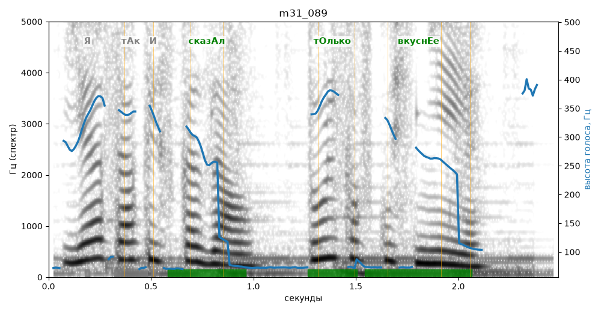

# m31_089

Голос: **Рон (серия 31, 279.1 с)** · длительность 2.5 с
Естественность (UTMOS): **2.0 из 5** (живой диктор ≈ 4–4.5)
Эталон: Я так и сказал. Только вкуснее.
Распознано: Я так и сказал, только вкуснее.
Слова: все совпали

## Ударения
(где нужно: ruaccent)

| слово | нужно | у голоса | |
|---|---|---|---|
| сказал | сказАл | сказАл | ✓ |
| только | тОлько | тОлько | ✓ |
| вкуснее | вкуснЕе | вкуснЕе | ✓ |

## Интонация
- ✓ «я так и сказал.» — конец фразы понижается — звучит законченно
- ✗ «только вкуснее.» — конец фразы не понижается — звучит незаконченно / как перечисление
- Диапазон голоса 28.7 полутонов (живо), средняя высота 181 Гц

## Паузы и темп
- паузы на своих местах
- Темп 5.7 слога/с (нормально)

_Синяя линия — высота голоса. Над словами заглавная буква — где ударение должно быть; красным — голос поставил не туда (уверенно), оранжевым — возможно._
