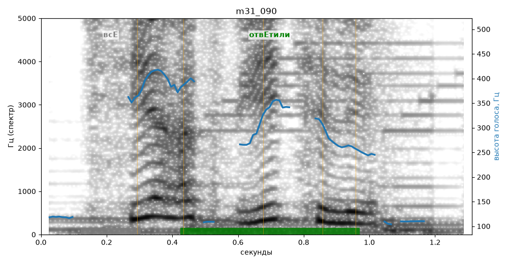

# m31_090

Голос: **Филя (серия 31, 281.7 с)** · длительность 1.3 с
Естественность (UTMOS): **1.51 из 5** (живой диктор ≈ 4–4.5)
Эталон: Все ответили!
Распознано: Все ответили!
Слова: все совпали

## Ударения
(где нужно: ruaccent)

| слово | нужно | у голоса | |
|---|---|---|---|
| ответили | отвЕтили | отвЕтили | ✓ |

## Интонация
- ✓ «все ответили!» — выделено слово «все» (+2.6 пт)
- Диапазон голоса 22.9 полутонов (живо), средняя высота 268 Гц

## Паузы и темп
- паузы на своих местах
- Темп 5.9 слога/с (нормально)

_Синяя линия — высота голоса. Над словами заглавная буква — где ударение должно быть; красным — голос поставил не туда (уверенно), оранжевым — возможно._
