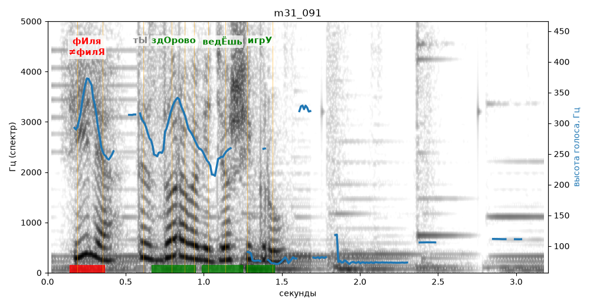

# m31_091

Голос: **Барсик (серия 31, 283.1 с)** · длительность 3.2 с
Естественность (UTMOS): **2.19 из 5** (живой диктор ≈ 4–4.5)
Эталон: Филя, ты здорово ведёшь игру.
Распознано: Филя, ты здорово ведешь игру!
Слова: все совпали

## Ударения
(где нужно: ruaccent)

| слово | нужно | у голоса | |
|---|---|---|---|
| филя | фИля | филЯ | ✗ ОШИБКА |
| здорово | здОрово | здОрово | ✓ |
| ведёшь | ведЁшь | ведЁшь | ✓ |
| игру | игрУ | игрУ | ✓ |

## Интонация
- ✓ «филя ты здорово ведёшь игру.» — конец фразы понижается — звучит законченно
- Диапазон голоса 26.5 полутонов (живо), средняя высота 111 Гц

## Паузы и темп
- паузы на своих местах
- Темп 9.0 слога/с (быстро)

_Синяя линия — высота голоса. Над словами заглавная буква — где ударение должно быть; красным — голос поставил не туда (уверенно), оранжевым — возможно._
