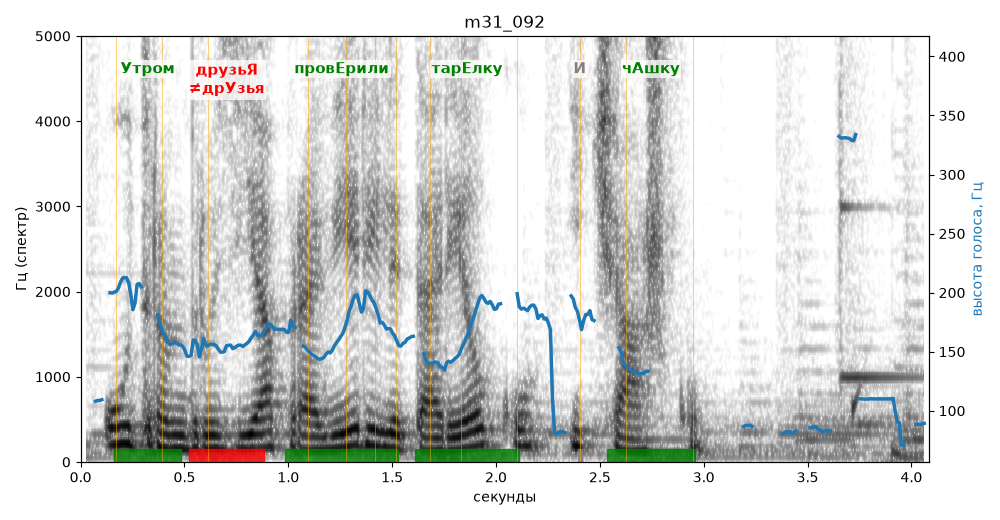

# m31_092

Голос: **Рассказчик (серия 31, 286.5 с)** · длительность 4.1 с
Естественность (UTMOS): **2.28 из 5** (живой диктор ≈ 4–4.5)
Эталон: Утром друзья проверили тарелку и чашку.
Распознано: Утром, друзья, проверили тарелку и чашку.
Слова: все совпали

## Ударения
(где нужно: ruaccent)

| слово | нужно | у голоса | |
|---|---|---|---|
| утром | Утром | Утром | ✓ |
| друзья | друзьЯ | дрУзья | ✗ ОШИБКА |
| проверили | провЕрили | провЕрили | ✓ |
| тарелку | тарЕлку | тарЕлку | ✓ |
| чашку | чАшку | чАшку | ✓ |

## Интонация
- ✓ «утром друзья проверили тарелку и чашку.» — конец фразы понижается — звучит законченно
- Диапазон голоса 15.9 полутонов (живо), средняя высота 156 Гц

## Паузы и темп
- паузы на своих местах
- Темп 5.2 слога/с (нормально)

_Синяя линия — высота голоса. Над словами заглавная буква — где ударение должно быть; красным — голос поставил не туда (уверенно), оранжевым — возможно._
