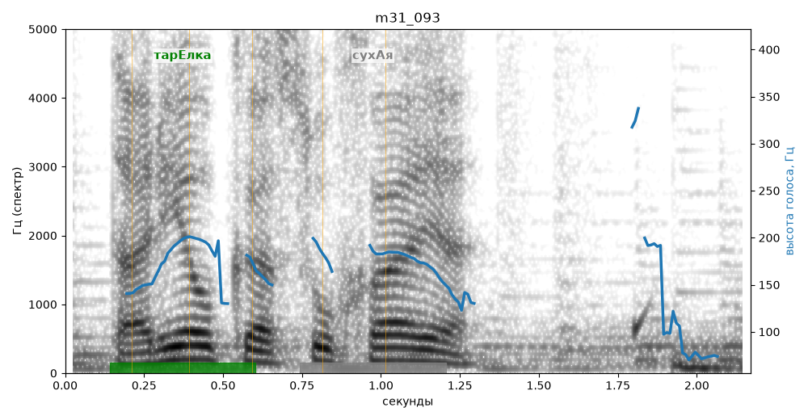

# m31_093

Голос: **Топа (серия 31, 290.7 с)** · длительность 2.2 с
Естественность (UTMOS): **2.72 из 5** (живой диктор ≈ 4–4.5)
Эталон: Тарелка сухая!
Распознано: Тарелка сухая.
Слова: все совпали

## Ударения
(где нужно: ruaccent)

| слово | нужно | у голоса | |
|---|---|---|---|
| тарелка | тарЕлка | тарЕлка | ✓ |
| сухая | сухАя | — | ? |

## Интонация
- ✗ «тарелка сухая!» — восклицание звучит ровно, без эмоции
- Диапазон голоса 17.2 полутонов (живо), средняя высота 172 Гц

## Паузы и темп
- паузы на своих местах
- Темп 4.7 слога/с (нормально)

_Синяя линия — высота голоса. Над словами заглавная буква — где ударение должно быть; красным — голос поставил не туда (уверенно), оранжевым — возможно._
