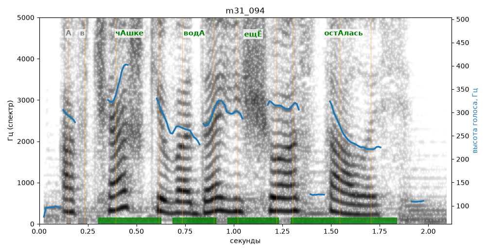

# m31_094

Голос: **Филя (серия 31, 293.0 с)** · длительность 2.1 с
Естественность (UTMOS): **2.98 из 5** (живой диктор ≈ 4–4.5)
Эталон: А в чашке вода ещё осталась.
Распознано: А в чашке вода еще осталась.
Слова: все совпали

## Ударения
(где нужно: ruaccent)

| слово | нужно | у голоса | |
|---|---|---|---|
| чашке | чАшке | чАшке | ✓ |
| вода | водА | водА | ✓ |
| ещё | ещЁ | ещЁ | ✓ |
| осталась | остАлась | остАлась | ✓ |

## Интонация
- ✓ «а в чашке вода ещё осталась.» — конец фразы понижается — звучит законченно
- Диапазон голоса 21.4 полутонов (живо), средняя высота 274 Гц

## Паузы и темп
- паузы на своих местах
- Темп 6.5 слога/с (нормально)

_Синяя линия — высота голоса. Над словами заглавная буква — где ударение должно быть; красным — голос поставил не туда (уверенно), оранжевым — возможно._
